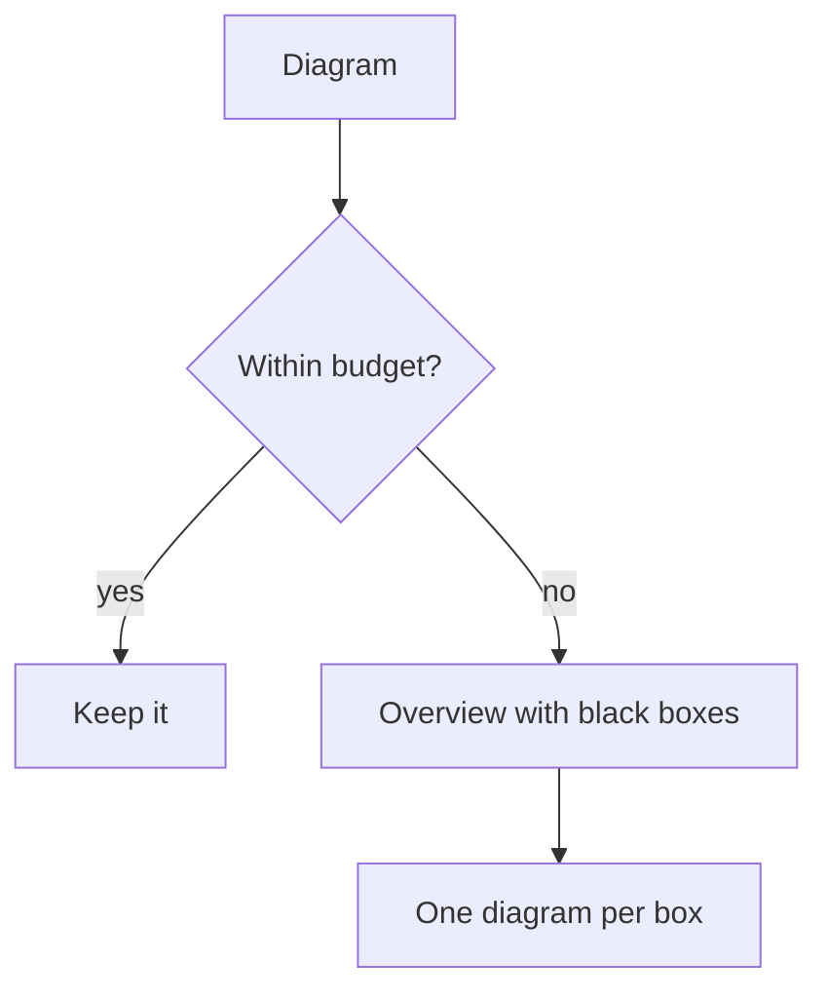

# an-dr-convention-diagram

How much one diagram may show, and how a bigger picture splits into an overview and its parts, with a script that measures every Mermaid diagram in Markdown and HTML.

## When it runs

A convention is read, never run. Every skill that draws or reviews a diagram uses it: documentation, READMEs, change reports, and specifications.

## How it works

A diagram costs what you hold in mind at once. Each diagram stays within a small budget:

| Measure                  | Limit                                |
| ------------------------ | ------------------------------------ |
| Nodes and labelled edges | 7                                    |
| Levels                   | 1: no group with its own inside      |
| Loops                    | 1                                    |
| Edge label               | 2 words, for a trigger or an outcome |
| Left-to-right run        | 4 nodes                              |

A diagram over budget is not squeezed. A group with its own inside becomes one black-box node in an overview, drawn differently from plain steps (a subroutine shape, or a heavier dashed box), and its inside gets its own diagram after a sentence that introduces it. Explanations move from the arrows into the prose.

`check-diagrams.py` counts what it can parse in `flowchart`, `graph`, and `stateDiagram` blocks; other types are listed as not measured. A generated reference graph opts out with a `%% diagram-budget: exempt <reason>` line.

## What you get

Diagrams you read at a glance, each with one idea, in the order the prose tells the story.

## Related skills

- [an-dr-dev-write-documentation](../../actions/an-dr-dev-write-documentation/README.md) — writes the prose around the diagrams and runs the check.
