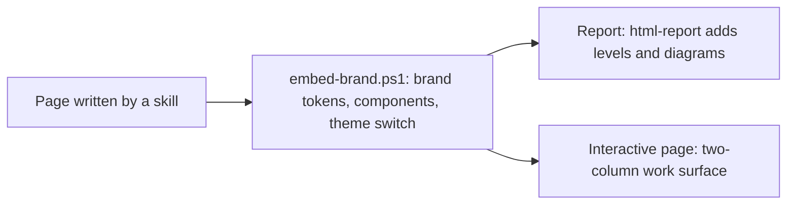

# an-dr-convention-html-repo-style

How every HTML page in this repository looks: one palette, one set of building blocks, one theme switch, in reports and in interactive pages alike.

## When it runs

A convention is read, never run. Any skill that builds an HTML page uses it; `embed-brand.ps1` applies it to a finished page.

## How it works

- **One file.** Inline CSS and scripts, nothing from the network.
- **Tokens only.** Every colour and font comes from the brand stylesheet; pages define none of their own.
- **Shared blocks.** Cards, notes, buttons, inputs, lists, and the two-column work surface come from one components sheet.
- **Status in words.** `doing`, `done`, `problem` are text; colour alone never carries a status.

## What you get

Pages that look the same wherever they appear, follow your theme, and print cleanly.

## Related skills

- [an-dr-convention-html-report](../an-dr-convention-html-report/README.md) — what only reports add: stamp, problem levels, diagrams.
- [an-dr-ai-use-user-interface](../../actions/an-dr-ai-use-user-interface/README.md) — the interactive page that uses this style.
