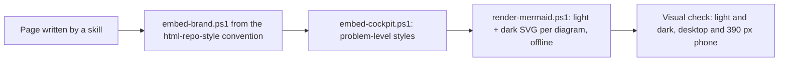

# an-dr-convention-html-report

What a report adds to the repository's HTML style: problem levels, diagrams rendered offline, and a visual check.

## When it runs

A convention is read, never run. Any skill that writes an HTML page for people uses it — reviews, change reports, overviews — and runs the brand script and its two scripts to finish the page.

## How it works

- **Style.** Looks and layout come from [an-dr-convention-html-repo-style](../an-dr-convention-html-repo-style/README.md).
- **Levels.** A page that reports problems uses the dark-cockpit levels and no other status colour.
- **Diagrams.** Mermaid renders in local headless Chrome or Edge; the page stores the source, with a "Copy Mermaid" button.
- **Verified** means screenshots in both themes at desktop and phone width were opened and inspected; otherwise the page is reported as unverified.

## What you get

Reports that work offline, print cleanly, respect your theme, and put problems where the eye lands.

## Related skills

- [an-dr-files-build-report](../../actions/an-dr-files-build-report/README.md) — runs the build steps.
- [an-dr-concept-dark-cockpit](../../concepts/an-dr-concept-dark-cockpit/README.md) — the level meanings.
- [an-dr-convention-artifact-layout](../an-dr-convention-artifact-layout/README.md) — where pages are saved.
