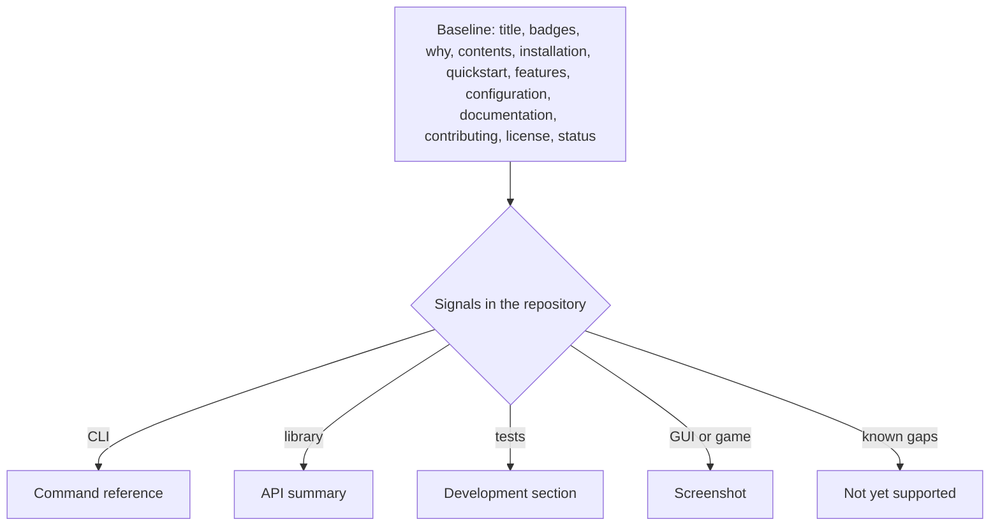

# an-dr-convention-readme

What a project README contains and in what order, and the rule that every statement in it is backed by the repository.

## When it runs

A convention is read, never run. Skills load it when writing, reviewing, or checking a README; `scripts/check-readme.ps1` compares a README against the repository.

## How it works

A fixed baseline, then modules only where the repository shows the signal:

**Truth rules.** No invented command, flag, or path; no license section without a `LICENSE`; no testing section without tests; no build badge without CI. A missing fact becomes a question for you, not a guess. Content that belongs in `docs/` or an ADR is linked, not summarised twice.

## What you get

A README a newcomer can trust, where every command exists. The checker reports unsupported claims, dead links, and missing or out-of-order sections.

## Related skills

- [an-dr-dev-write-readme](../../actions/an-dr-dev-write-readme/README.md) — writes READMEs to this shape.
- [an-dr-concept-evidence-grounding](../../concepts/an-dr-concept-evidence-grounding/README.md) — the truth rules' basis.
