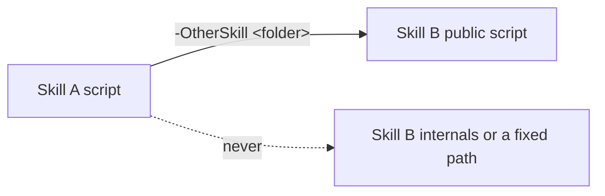

# an-dr-convention-script

Rules for the PowerShell scripts a skill ships: PowerShell 7, non-interactive, tested, self-contained, and with output an agent can relay without reshaping.

## When it runs

A convention is read, never run. Skills load it when writing, changing, or reviewing any script under a skill; `scripts/check-scripts.ps1` checks a repository against it.

## How it works

- **Only for mechanical work.** A script exists for repeated, deterministic steps; `SKILL.md` says when it runs.
- **Runtime.** PowerShell 7, `#Requires -Version 7`, never prompts, exits non-zero on failure.
- **Tested after every change**, against the final edited script; missing tests are reported, never claimed as success.
- **Output for people.** Markdown tables and short status lines between `user-output` markers, saying whether the agent relays them verbatim or summarises them.
- **Self-contained.** Own files through `$PSScriptRoot`. Another skill is reached only through its public script, in a folder passed as a parameter, so each skill still works when installed alone.

## What you get

Scripts that run the same on any machine, fail loudly, and print results you can read directly.

## Related skills

- [an-dr-convention-agent-skill-testing](../an-dr-convention-agent-skill-testing/README.md) — test layout and runners.
- [an-dr-ai-send-message](../../actions/an-dr-ai-send-message/README.md) — the output form.
