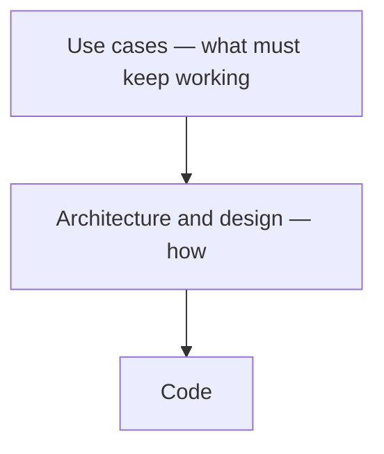

# an-dr-convention-use-case

What a use case is and how it is written: the layer above architecture that says what must keep working, with stable identifiers and observable behaviour only.

## When it runs

A convention is read, never run. Skills load it when adding a capability, writing or reviewing a use case, or judging whether a change breaks something users rely on.

## How it works



Use cases live in `docs/use-cases/`: an `index.md` defining actors and areas, and one file per area.

```markdown
### UC-CLI-03: Export a report as PDF
- **Actor**: analyst
- **Goal**: share a report with someone without the tool
- **Flow**: run `tool export report.json --pdf`
- **Success**: `report.pdf` opens with every chart
```

- Identifiers stay when a use case is reworded or moved, and are never reused.
- Observable behaviour only — commands, visible files, results — so an ordinary refactoring changes no use case.
- A change that breaks a use case is a breaking change, whatever the code looks like.

## What you get

A list a newcomer can read without the code, and a clear test of whether a change breaks users.

## Related skills

- [an-dr-dev-write-specification](../../actions/an-dr-dev-write-specification/README.md) — writes use cases for new capabilities.
